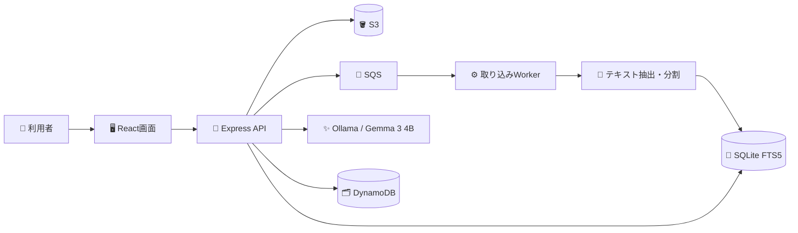
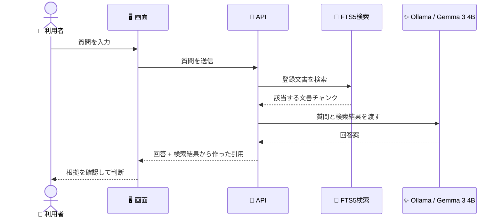

# 🤖 AI Manufacturing PoC

作業現場の文書を登録し、根拠を確認しながら質問できるナレッジアシスタントと、設計レビューの指摘候補を作るPoCです。

> 🧭 まず動かす: [`pnpm dev:local`](#-最短で起動)　|　🖥️ [操作マニュアル](./docs/user-manual.md)　|　🏗️ [アーキテクチャ](./docs/architecture.md)　|　🗺️ [実運用への移行計画](./docs/production-migration-plan.md)

## 🎯 このPoCでできること

| やりたいこと | 使う画面 | できること |
| --- | --- | --- |
| 📚 手順書やFAQを登録する | 文書ライブラリ | ファイルを登録し、検索に使える状態を確認 |
| 🔎 登録文書を根拠に質問する | ナレッジアシスタント | 回答と引用元を表示。根拠がなければ推測で補わない |
| 🧪 設計文書を確認する | 設計レビュー | 指摘候補を提示し、人が採用・却下・修正を記録 |

### 🧩 システムの流れ



### 💬 質問から回答まで



## 🚀 最短で起動

### 必要なもの

| 🧰 必要なもの | 用途 |
| --- | --- |
| Node.js 26以上、pnpm 12以上 | アプリとWorkerの実行 |
| Docker DesktopまたはDocker Engine | ローカルAWS Emulatorの実行 |
| Ollamaと `gemma3:4b` | ローカルLLM推論 |
| 空いているポート `9297`、`3000`、`5173`、`11434` | Emulator、API、画面、Ollama |

### 起動手順

```sh
pnpm dev:local
```

1. 初回は `.env.example` をもとに `.env` と依存関係を準備します。
2. DockerでAWS Emulatorを起動し、DynamoDB・S3・SQSを初期化します。
3. API、画面、文書取り込みWorkerが起動したら <http://localhost:5173> を開きます。
4. 初期ログインは `operator` / `change-me` です。ローカル開発専用の値なので、共有環境や公開環境では必ず変更してください。
5. 終了するときは起動中のターミナルで `Ctrl+C` を押します。

> 💡 既定値は `AUTH_PROVIDER=local`、`LLM_PROVIDER=ollama` です。Ollamaが起動しておらず `gemma3:4b` が取得されていない場合、質問・設計レビューは利用できません。EmulatorのDynamoDB/S3/SQSはメモリ上にあるため、停止するとデータが消えます。実AWSの認証情報はローカル起動に使いません。

### 🛠️ 手動で起動する場合

```sh
pnpm install
cp .env.example .env
# .env の認証情報・AWS Emulator接続先を確認
pnpm aws:init
pnpm dev
```

別ターミナルで `pnpm worker` を起動します。AWS Emulatorのcredential・config・CAファイルの設定や、実AWSを使う場合の注意は[アーキテクチャ資料](./docs/architecture.md#ローカル起動とデータの扱い)を参照してください。

## 🧭 画面の使い方

| 順番 | 画面 | 操作 |
| --- | --- | --- |
| 1️⃣ | 文書ライブラリ | TXT / Markdown / PDF / DOCX / XLSXを登録し、「利用可能」になるまで待つ |
| 2️⃣ | ナレッジアシスタント | 質問し、回答と引用元の文書・箇所を確認する |
| 3️⃣ | 設計レビュー | 種別が「設計書」の文書を選び、候補ごとに人が判断する |

詳しい画面画像付きの手順は[操作マニュアル](./docs/user-manual.md)をご覧ください。

## ⚙️ 接続先の選び方

| 設定 | 既定値 | 切り替え先 | 注意点 |
| --- | --- | --- | --- |
| `AUTH_PROVIDER` | `local` | `cognito` | CognitoではUser Pool等の設定とユーザー登録が必要。MFA等の追加チャレンジは現在のログイン画面では完了できません |
| `LLM_PROVIDER` | `ollama` | なし | Ollamaはloopback/private IPに限定。既定モデルは `gemma3:4b` |
| 検索 | SQLite FTS5 | 現状、設定切替なし | 検索Providerの差し替えには別実装とデータ移行が必要 |
| 保存・キュー | AWS SDK | `AWS_ENDPOINT_URL`等で接続先選択 | Emulatorと実AWSの切替は可能ですが、本番用IaC・IAM・環境分離は別途必要 |

🌱 Provider境界は、PoCの接続先を選びやすくするためのものです。すべての基盤を設定値だけで他製品へ交換できる、という意味ではありません。詳細は[アーキテクチャ資料](./docs/architecture.md#providerと外部サービス)を参照してください。

☁️ AWSインフラのIaCには **AWS CDK（TypeScript）** を採用しました。S3・DynamoDB・SQSの基盤Stackを用意し、アカウントなしで合成・テストできます。実AWSへのデプロイ、実行基盤、VPC、Cognito等はまだ未実装です。

```sh
pnpm cdk:test
pnpm cdk:typecheck
pnpm cdk:synth
```

詳細は[CDK基盤のREADME](./infra/cdk/README.md)を参照してください。`.env.example` はアプリ実行時の接続設定で、CDKのデプロイ用認証情報は含めません。

## ✅ チェックとCI

| コマンド | 確認内容 |
| --- | --- |
| `pnpm test` | API、認証、検索、取り込み、LLMのユニットテスト |
| `pnpm lint` | Backend、Frontend、スクリプト、E2Eの静的検査 |
| `pnpm build` | Frontendの本番用ビルド |
| `pnpm test:e2e` | 画面操作のE2Eテスト（外部サービスはテスト用スタブ） |
| `pnpm test:e2e:ollama` | AWS Emulator・API・Worker・Gemma 3 4Bを通した文書登録・質問E2E |

ローカルではOllamaを起動して `gemma3:4b` を取得し、別ターミナルで `pnpm dev:local` を起動した状態で `pnpm test:e2e:ollama` を実行します。公式AWS Emulator上のDynamoDB・S3・SQS、実API、取り込みWorker、SQLite FTS5検索、Gemma回答までを通して、異音対応・始業前確認・清掃前の安全措置を検証します。回答JSONと動画はPlaywrightレポートに保存され、`pnpm exec playwright show-report` でViewerを開けます。動画は回答生成後に回答欄を画面内へスクロールし、ローディング表示が消えて回答本文が見える状態を2秒保持してから終了します。通常の `pnpm test:e2e` は従来どおりAPIスタブを使う高速な画面テストです。

GitHub Actionsはテスト・lint・本番ビルド・CDK合成・E2Eを実行しますが、実AWSへはデプロイしません。E2Eでは公式AWS Emulator、Ollama/Gemma 3 4B、API、Workerを起動して実運用に近い登録・検索・回答フローを検証します。将来の実AWSデプロイではAWS OIDC、環境承認、変更確認、ロールバック等を整備します。

## ⚠️ 対象範囲と安全上の注意

- このPoCは全文検索（SQLite FTS5）を使います。ベクトル検索、OCR、動画文字起こし、図面解析は行いません。
- 対応ファイルはTXT、Markdown、PDF、DOCX、XLSXです。画像だけのPDF等、文字を抽出できない資料は別途確認が必要です。
- Ollama利用時も、出力の品質や正確性を保証するものではありません。
- AI回答は参考情報です。安全作業は承認済みの最新版文書と現場の手順を確認してください。設計の最終判断は担当者が行ってください。
- 現在の文書・レビュー領域は共有ワークスペースです。ログインを分けても、文書ごとの権限分離は行われません。

📖 構成の詳細、データの流れ、制約は[アーキテクチャ資料](./docs/architecture.md)、実運用へ移るための課題と段階案は[移行計画](./docs/production-migration-plan.md)を参照してください。
