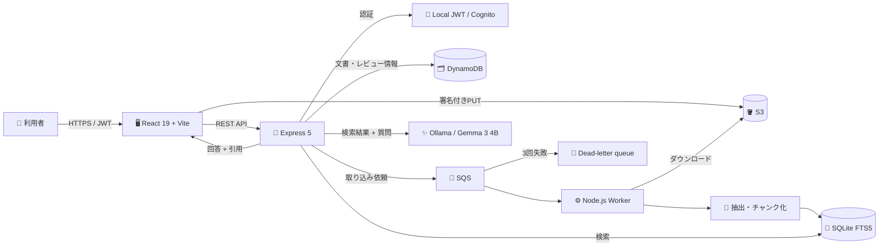
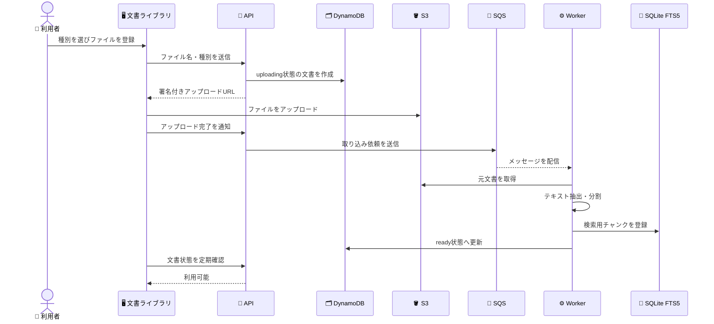
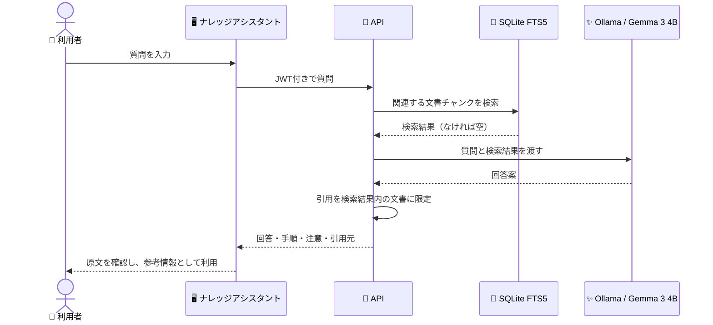
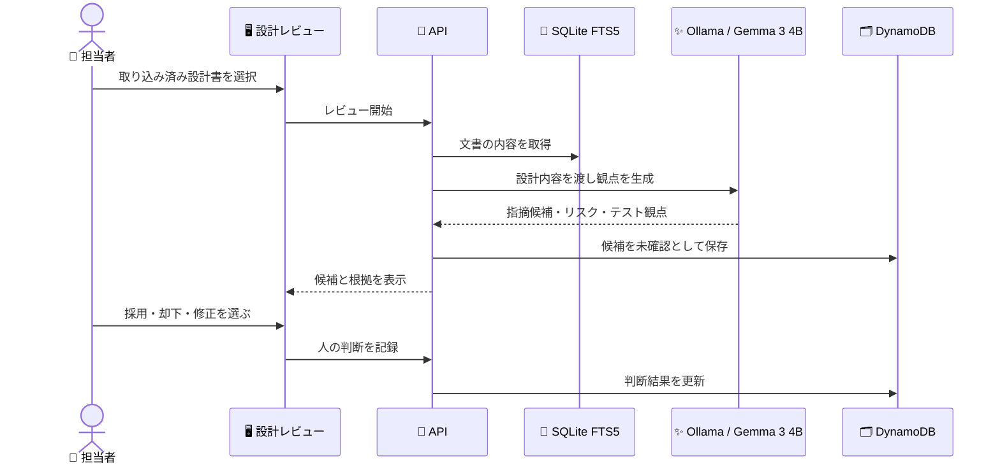
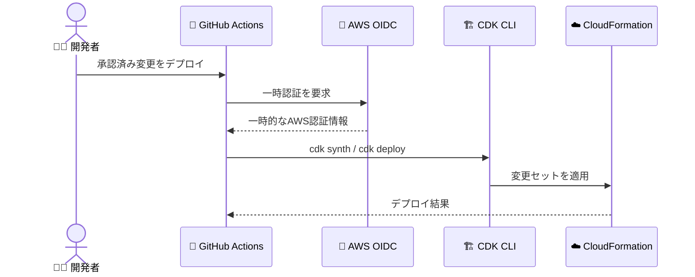

# 🏗️ PoCの構成とデータの流れ

この資料では、利用者の操作が画面から保存・検索・AI応答までどう届くかを説明します。現在の構成と、本番化に向けてまだ必要なものを分けて記載しています。

## 🧭 全体像



### 🧱 コンポーネント一覧

| 部品 | 主な役割 | 現在の実装 |
| --- | --- | --- |
| 🖥️ Frontend | ログイン、文書登録、質問、レビュー | React 19、Vite、React Router |
| 🔐 API | JWT認証、文書・検索・レビューのAPI | Express 5 |
| ⚙️ Worker | SQSから取り込み依頼を読み、文書を索引化 | Node.js long polling |
| 🪣 オブジェクト保存 | 元文書の保存・取得 | S3と短時間の署名付きURL |
| 🗂️ メタデータ | 文書、レビュー、ローカル利用者 | DynamoDB |
| 🔎 全文検索 | 文書チャンクの検索 | SQLite FTS5、trigram tokenizer |
| ✨ 回答・レビュー生成 | 検索結果を使った回答や指摘候補 | Ollama adapter（Gemma 3 4B） |

## 📥 文書登録から検索可能になるまで



- ✅ 文書一覧で状態が「利用可能」になってから質問や設計レビューに使えます。
- ⚠️ 取り込み失敗時はSQSが最大3回まで再配信し、その後DLQへ移します。DLQの監視・再送運用は別途整備が必要です。

ローカルEmulatorはS3のCORS応答を返さないため、署名付きURLをViteの同一オリジンproxy経由で利用します。実AWSでは署名付きURLをS3へ直接送信し、bucket CORSで画面のoriginを許可します。

取り込みに失敗したメッセージは削除せず、SQSが再配信します。最大3回失敗するとDLQへ移動します。現在、DLQのアラームや管理画面からの再送はありません。

## 💬 質問と根拠表示



引用元は検索結果から選びます。LLMに引用位置を自由生成させません。該当資料がない場合は根拠なしとして扱い、推測回答を補完しません。回答への評価はSQLiteに保存されます。

## 🧪 設計レビューと人の判断



🚦 生成結果は常に候補です。根拠と設計要求を確認した担当者が採否を決め、最終承認を行います。

## 🔌 Providerと外部サービス

| 領域 | 設定・境界 | 選択できるもの | まだできないこと |
| --- | --- | --- | --- |
| 🪪 認証 | `AUTH_PROVIDER` | `local` / `cognito` | Cognito MFA等の追加challengeを現在の画面で完了する |
| ✨ LLM | `LLM_PROVIDER=ollama` | Ollama（Gemma 3 4B） | 別のローカル/閉域モデルへ切り替える |
| 🔎 検索 | `createSearchProvider(database)` | SQLite FTS5のDB注入 | 設定値だけで検索エンジンを別製品へ切替 |
| 🗂️ 保存・キュー | AWS SDK設定 | Emulator / 実AWSの接続先 | 保存基盤全体の抽象化や自動データ移行 |

## 🏗️ AWS構築とデプロイ方針

| 項目 | 方針 | 状態 |
| --- | --- | --- |
| ☁️ IaC | AWS CDK（TypeScript）でAWSリソースを定義し、CloudFormation経由で構築 | S3・4つのDynamoDB・SQS/DLQ・DLQ CloudWatch alarmを実装。AWSデプロイは未実施 |
| 🖥️ 実行基盤 | 単一EC2案とECS等を費用・運用要件で比較 | 未決。CDK採用とは独立して判断 |
| 🔐 CI認証 | GitHub ActionsからAWS OIDCで一時認証 | 未実装。長期アクセスキーは使わない方針 |
| 🧰 環境設定 | アプリ実行設定とインフラ構築設定を分離 | `.env.example`はローカル/アプリ実行用 |

Foundation Stackは、非公開・暗号化したS3バケット、オンデマンド課金のDynamoDB 4テーブル、暗号化SQSキューを定義します。環境別のリソース名とCloudFormation outputsを生成し、アプリの`S3_BUCKET`、`*_TABLE_NAME`、`DOC_INGEST_QUEUE_URL`へ設定できます。データリソースはStack削除時に保持します。

実行基盤を選ぶ前のため、VPC/セキュリティグループ、EC2またはECS、Cognito、アプリ用IAMロール、バックアップ、通知付き監視はまだ含めていません。これらは実行基盤、IdP、RPO/RTO、予算の決定後にStackへ追加します。SQSには3回でDLQへ移すredrive policyと、DLQにメッセージが1件以上ある場合のCloudWatch alarmを設定しています。AlarmはCloudWatch上で状態を示しますが、メール等への通知先と再送手順は未設定です。



上図は今後整備するデプロイ方式です。現行のGitHub Actionsはテスト・lint・E2E・CDK合成を行いますが、CDK Bootstrap、AWS OIDCロール、CDKデプロイはいずれも未実装です。AWSアカウント/リージョンごとのBootstrap、最小権限、承認、変更差分の確認、ロールバックを設計します。AWSアカウントがなくても`pnpm cdk:synth`、`pnpm cdk:test`、`pnpm cdk:typecheck`でローカル検証できます。

`.env.example`の`AWS_REGION`や`AWS_ENDPOINT_URL`はアプリがAWS SDKで接続するための実行時設定です。ローカル既定リージョンは`us-east-1`、endpointはローカルEmulatorです。計画中の東京リージョン向けCDK設定やAWSデプロイ資格情報をここへ追加しません。

### 🪪 認証

- `AUTH_PROVIDER=local` はDynamoDB `Users` のscryptハッシュを照合し、ローカルJWTを発行します。初期ユーザー設定は `.env` の `AUTH_USERNAME` / `AUTH_PASSWORD`、または `AUTH_USERS_JSON` です。
- `AUTH_PROVIDER=cognito` はCognito `USER_PASSWORD_AUTH` を使い、APIがID tokenを検証します。`COGNITO_REGION`、`COGNITO_USER_POOL_ID`、`COGNITO_CLIENT_ID` とアプリクライアント設定が必要です。
- Cognitoのユーザー登録・MFA・アカウント復旧の運用は別途整備が必要です。現行画面は追加認証challengeを完了できません。
- ログインセッションは利用者ごとに分離されますが、文書・レビューは共有ワークスペースです。文書単位の認可はありません。

### ✨ LLM

- `ollama` は唯一のLLM Providerです。`OLLAMA_BASE_URL`、`OLLAMA_MODEL`、`OLLAMA_TIMEOUT_MS` で設定します。既定モデルは `gemma3:4b`、接続先はloopback/private IPに限定され、外部ホスト名は拒否されます。
- モデルに引用を自由生成させず、検索で取得したチャンクに引用範囲を固定します。
- 実モデルの品質、日本語性能、応答時間、必要メモリ、同時実行時の費用は未検証です。文書を外部へ送らない評価環境で確認してください。
- `pnpm test:e2e:ollama` とアプリ検証/E2EのGitHub Actionsでは、公式AWS Emulator、API、Workerを起動し、文書登録からS3保存、SQS取り込み、SQLite FTS5検索、Ollama ProviderによるGemma 3 4B回答までを通します。質問応答の3シナリオに加えて、設計書を登録し、取り込み完了後に設計レビューを実行し、指摘候補の根拠を確認して人の判断を記録するシナリオを検証します。回答JSON・レビューJSON・結果画面のスクリーンショット・動画をPlaywright Viewerに記録します。録画とスクリーンショットは1280 x 720で、各結果を表示した後に2秒間保持します。AIの出力文は完全一致で判定せず、結果の存在・引用根拠と登録文書との対応を検証し、実際の回答と画像を[操作マニュアル](./user-manual.md)に掲載します。AWS Emulatorはローカル検証用で、実AWSへのデプロイや本番環境との完全同等性を保証するものではありません。

## 💾 データと永続性

| データ | 保存場所 | ローカルPoCでの注意 |
| --- | --- | --- |
| 元文書 | S3 | AWS Emulatorではメモリ上。停止で消去 |
| 文書・レビュー情報 | DynamoDB | AWS Emulatorではメモリ上。停止で消去 |
| 取り込み依頼 | SQS | AWS Emulatorではメモリ上。停止で消去 |
| 検索チャンク・評価 | SQLite (`SQLITE_PATH`) | ディスク上のDB。単一ローカル環境向け |
| Emulatorのcredential/config/CA | `~/.aws/emulator/` | Emulator停止後もファイルが残る |

🔒 実AWSでの本番運用には、アカウント/環境分離、IAM最小権限、秘密情報管理、暗号化、バックアップ、復元検証、ネットワーク境界、監査と監視が必要です。

## 🧰 ローカル起動とデータの扱い

### 簡易起動

```sh
pnpm dev:local
```

Node.js 26以上、pnpm 12以上、Dockerが必要です。スクリプトはAWS EmulatorのHTTPS readinessを確認し、DynamoDB・S3・SQSを初期化した後に画面、API、Workerを起動します。ブラウザーは <http://localhost:5173>、APIはport `3000`、Emulatorは `9297` を使用します。終了はターミナルで `Ctrl+C` です。

### 初期ユーザーとEmulator

- `.env.example` から作られた既定ユーザーは `operator` / `change-me` です。ローカル開発専用であり、公開環境では使わないでください。
- EmulatorのDynamoDB/S3/SQSはコンテナ停止で消去されます。SQLite DBは `.data/manufacturing.db` に保存されます。
- 9297番portが使用中なら競合元を確認して停止するか、Emulatorのport設定を変更してください。
- Linuxで署名付きURLやAPIがTLSエラーになる場合は、Emulatorが生成したCA bundleをSDK環境変数に設定し、ブラウザー側でもCA証明書を信頼させる必要があります。
- このPoCのローカル起動には実AWSのアクセスキーを設定しないでください。

## ✅ 検証とCI

| 検証 | コマンド | 内容 |
| --- | --- | --- |
| 🧪 Unit/API | `pnpm test` | 認証、取り込み、全文検索、LLM Providerなど |
| 🧹 静的検査 | `pnpm lint` | Backend、Frontend、スクリプト、E2E |
| 🖱️ UI E2E | `pnpm test:e2e` | ログイン、登録、根拠表示、設計レビュー、人の判断 |

GitHub Actionsは手動実行、アプリ/CDK関連ファイルの変更時にテスト・lint・CDK合成・E2Eを行います。**AWSへのデプロイは行いません。** default branchのレポート公開にはGitHub Pagesを使います。実AWSへのCI/CDにはAWS OIDC、環境承認、デプロイ・ロールバック手順が別途必要です。

## 🚧 現在の制約

- SQLite FTS5はローカルディスク上にあり、複数API/Worker間で共有できません。水平スケール前に共有検索基盤への移行が必要です。
- 文書一覧などのDynamoDBアクセスは本番向けの容量・アクセスパターン最適化が未完了です。
- SQSの3回再試行とDLQは設定済みです。DLQアラーム、メッセージ調査・再送、障害時の運用手順は未整備です。
- OCR、動画・図面解析、ベクトル検索、複雑な承認フローは対象外です。
- AI出力は正確性や安全性を保証しません。安全作業は承認済み原文を確認し、設計判断は担当者が行ってください。

📖 次に読む: [画面付き操作マニュアル](./user-manual.md) · [実運用への移行計画](./production-migration-plan.md)
