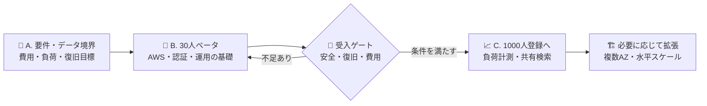
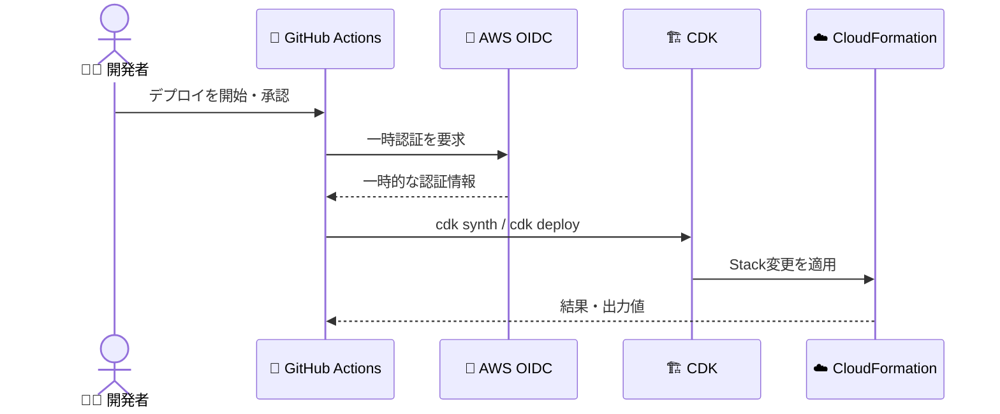
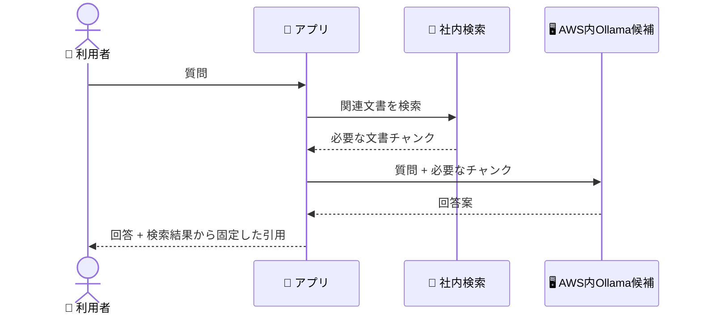

# 🗺️ PoCから実運用への移行計画

## 🎯 目標と進め方

東京リージョンのAWS上で社内限定の試し運用を始め、費用・データ保護・運用体制を確認しながら拡張します。最初の目安は登録ユーザー約30人、ピーク同時利用約10人です。登録ユーザー約1000人への拡張は、同時利用数やデータ量を計測してから設計します。

| 段階 | 対象 | 判断ポイント |
| --- | --- | --- |
| 🧭 A | 運用要件を決める | 予算、データ分類、同時利用、RPO/RTO、保存期間 |
| 🧪 B | 約30人・同時約10人の社内ベータ | 認証、バックアップ、監視、復旧、実費 |
| 📈 C | 約1000人の登録ユーザー | 同時利用数・検索負荷を測定し、共有基盤を選ぶ |

## ❓ 前提と着手前に決めること

- AWS東京リージョンを利用します。月額約1,000円は目標であり、可用性・バックアップを備えた場合の費用とは分けて見積もります。
- AWSインフラのIaCにはAWS CDK（TypeScript）を採用します。アカウントに依存しないFoundation Stack（S3、DynamoDB 4テーブル、SQS）を実装し、synthとテストをローカルで実行できます。AWSアカウントへのデプロイはまだありません。
- CDK採用と実行基盤選定は別の判断です。30人ベータの単一EC2案とECS等を費用・運用要件で比較してから、CDK Stackの構成を決めます。
- 利用者が登録した文書を外部推論サービスへ送らない方針です。AWS EC2上のOllamaを候補とし、Bedrockは方針変更がある場合のみ再評価します。
- GitHub Copilot Pro / CLIは開発支援用途です。利用者向け推論基盤には採用せず、契約・データ取り扱いが確認されるまで業務データを入力しません。
- Cognitoを認証候補とし、ローカル認証も残します。MFA等の追加チャレンジを含む公開運用要件は未確定です。
- 1000人は登録ユーザー数であり、1000同時接続を意味しません。

| 決める項目 | なぜ必要か | 確認事項 |
| --- | --- | --- |
| 💰 月額上限 | 低費用と可用性・バックアップが両立しない場合がある | 目標額と許容上限を分ける |
| 👥 ピーク同時利用 | 登録人数だけでは容量を決められない | 30人/1000人時の同時利用数 |
| 🔐 データ分類 | 認証、暗号化、監査、LLM選定に影響 | 外部LLM禁止範囲、保存期間 |
| 🛟 障害復旧 | バックアップ頻度と費用に影響 | RPO/RTO、停止許容時間、復元試験 |
| 🪪 IdP・権限 | Cognitoと既存SSO、文書共有範囲を決める | MFA、ロール、利用者の棚卸し |
| ✨ 推論方式 | 品質・応答時間・費用・データ境界に影響 | 評価データ、受入基準 |

## 🔎 現状と残課題

| 領域 | 現在 | 実運用に必要な作業 |
| --- | --- | --- |
| 🧩 アプリ | React/Vite、Express API、SQS Worker | 実AWS構成、CDK Stack、環境分離 |
| ☁️ AWS | ローカルはEmulator。CDK Foundation Stackはsynth/test可能 | 実AWSデプロイ、IAM最小権限、実行基盤、秘密情報、監視 |
| 🔎 検索 | SQLite FTS5をローカルディスクに保存 | 複数インスタンスで共有できる検索基盤 |
| 🗂️ データ | DynamoDB文書一覧でScan、文書・レビューは共有 | Query/GSI、ページネーション、権限キー |
| 📨 キュー | SQS Workerが文書を取り込み | 再試行、DLQ、冪等性、失敗時状態遷移 |
| 🪪 認証 | Local / Cognito Provider | User Pool IaC、MFA、権限、復旧、監査 |
| 🚀 CI/CD | GitHub Actionsでテスト・lint・E2E・CDK合成 | AWS OIDC、承認、デプロイ、ロールバック |

現状のProvider境界は軽量な差し替え口です。検索や保存層を設定だけで他製品へ切り替えるものではなく、別実装とデータ移行が必要です。実Ollamaモデル、Cognito User Pool、実AWS統合試験は未実施です。

## 🛣️ 段階ごとの作業

### 🧭 A. 要件・費用・データ境界の確定 — 規模 M

月額上限、無料枠対象アカウントか、停止可能時間、可用性、RPO/RTO、保存期間、文書の機密区分、IdP、LLM禁止範囲、1000人時の同時利用数を決めます。AWS Pricing Calculator等で東京リージョンの固定費・従量費を比較します。

### 🧪 B. 約30人・同時約10人の社内限定ベータ — 規模 L

1. 単一EC2上のコンテナ案とECS等のマネージド構成を、費用・運用・障害影響で比較します。約1,000円を厳格上限とする場合、常時稼働・バックアップ・冗長化をすべて満たすのは難しい可能性があります。
2. 既存のFoundation Stackを拡張し、選定した実行基盤と必要なAWSリソースをCDKで定義します。開発・検証・本番相当の環境分離、IAM最小権限、秘密情報管理、暗号化、ネットワーク境界をStackに反映します。
3. SQLite索引の永続化とバックアップ/リストアを整備し、単一インスタンス制約を明文化します。SQSに再試行・DLQ・冪等処理を追加します。
4. Cognitoまたは既存IdPを比較し、ユーザー管理、MFA、ロール、共有ワークスペースの境界を決めます。
5. 初期はLLM Mockを維持します。Ollamaは社内管理下の環境で、機密文書を外部へ送らずに品質・日本語性能・レイテンシ・必要メモリ・費用を評価します。
6. 各AWSアカウント/リージョンでCDK Bootstrapを行い、GitHub ActionsからのCDKデプロイはOIDCを使います。長期アクセスキーを保存せず、承認、変更差分の確認、ロールバック手順を加えます。
7. CloudWatchのログ・メトリクス・アラーム、AWS Budgets通知、障害対応、バックアップ復元確認を整えます。

**受入ゲート 🚦**: 認証・権限、費用、データ保護、復旧手順、監視、運用責任者を確認してから利用者を増やします。

このデプロイ手順は計画であり、現行CI/CDには含まれていません。

### 📈 C. 約1000人登録への拡張 — 規模 L

- 登録数とピーク同時利用数を分けた負荷試験で、API、Worker、アップロード、検索、SQS滞留を計測します。
- APIを水平スケールする場合はSQLite FTS5を共有検索基盤へ移行します。RDS PostgreSQL全文/trigram検索、またはOpenSearchを検索品質・運用・費用で比較します。
- DynamoDBのScanをやめ、ページネーション、Query/GSI、テナント/権限キーを設計します。Workerはキュー深度に応じてスケールさせます。
- 可用性・災害復旧・監査要件に応じ、単一ホストからECS等の複数AZ構成を評価します。ALB/NAT等の固定費も再見積します。
- ピーク同時利用、文書容量・件数、取り込み頻度、検索QPS、保持期間を確定してから容量を決めます。

## ✨ LLMの選択とデータの流れ

| 選択肢 | 役割 | 注意点 |
| --- | --- | --- |
| 🧪 Mock | 開発、CI、画面確認 | 実推論ではなく、既定の動作確認用 |
| 🖥️ AWS EC2上のOllama | AWS内セルフホスト推論の候補 | 推論用CPU/GPU・メモリ・常時稼働費用を評価。閉域接続とモデル評価が必要 |
| 🧰 Copilot CLI | 開発者向けコーディング支援 | 利用者向け常時稼働APIには採用しない。契約・データ取扱い確認前に業務文書を入力しない |
| ☁️ Bedrock | 管理型推論サービスの候補 | 外部推論へ文書を送らない現方針では採用しない。方針変更時のみ再評価 |

🛑 図は目標とするデータ境界案です。OllamaのEC2配置は未実施で、現行の既定値はMockです。Copilot CLIは運用LLMとは別の用途です。

## ⚖️ 構成と費用の暫定比較

| 構成 | 30人ベータ | 1000人登録への拡張 | 約1,000円との関係 |
| --- | --- | --- | --- |
| 🖥️ 単一EC2 + Docker + S3/DynamoDB/SQS | 固定費を抑えやすい候補。SQLite FTS5をEBSに置きAPI/Workerを同居。単一障害点 | 同時利用・検索負荷次第でCPU/メモリや単一ノード検索が限界 | 無料枠/クレジット対象の限定ベータ候補。EBS、IPv4、バックアップ、ログ、転送を含め実見積が必要 |
| 🏗️ ECS/Fargate + ALB + 複数AZ | 運用標準化に向くが、常時起動タスク・ALBの費用が増える | API/Workerの独立スケール、デプロイ、冗長化に向く | 厳格な月約1,000円上限とは両立しにくい。NAT Gatewayも別費用 |
| 🧠 AWS内セルフホストLLM | Mock継続、または小型モデルをCPU/GPUで検証 | 推論サービス分離、同時実行、モデル更新、GPU利用率の管理 | 常時稼働で目標を超える可能性が高く、別枠で測定・見積もる |
| ☁️ Bedrock | 現方針では対象外 | ポリシー許可時のみ比較 | 文書をマネージド推論へ送る扱いが未承認 |

月約1,000円の低費用案と、バックアップ・冗長化を備えた本番相当案は分けて見積もります。無料枠はアカウント条件・対象サービス・期間に依存します。EC2常時稼働、EBS、IPv4、ログ、データ転送、バックアップ、推論費を含めて確認し、無料枠を恒久的な運用費の根拠にしません。

料金確認先: [EC2](https://aws.amazon.com/ec2/pricing/on-demand/)、[Fargate](https://aws.amazon.com/fargate/pricing/)、[ALB](https://aws.amazon.com/elasticloadbalancing/pricing/)、[VPC/NAT Gateway](https://aws.amazon.com/vpc/pricing/)、[AWS Pricing Calculator](https://calculator.aws/)

## 🧾 タスク一覧

| # | 作業 | 完了の目安 | 規模 |
| --- | --- | --- | --- |
| 1 | 運用要件・費用上限・データ分類・ピーク負荷・RPO/RTOを定義 | 運用条件と受入基準を合意 | M |
| 2 | 30人ベータと1000人向け構成・費用を比較 | 構成案・見積・未決事項を比較表にする | M |
| 3 | AWS CDK Foundation Stackを拡張し、環境分離、IAM、秘密情報管理を整備 | `cdk synth`、再現可能な環境、最小権限を確認 | L |
| 4 | 永続化、SQLite索引のバックアップ、SQS再試行/DLQを整備 | 失敗・復旧シナリオを試験 | L |
| 5 | IdP、MFA、ロール、文書アクセス境界を実装 | 認証・認可要件をテストで確認 | M/L |
| 6 | Copilot CLI、Ollama、Bedrockのデータ境界・品質・費用を評価 | 採用/不採用と根拠を記録 | M |
| 7 | GitHub ActionsのAWS OIDC/CDKデプロイ、承認、ロールバックを整備 | 長期キーなしのデプロイと復旧を確認 | M |
| 8 | 監視、予算アラート、復元確認、運用手順を整備 | アラート受信・復元を演習 | M |
| 9 | 30人/同時10人のベータ受入・セキュリティ確認 | 受入条件に基づきベータ可否を判断 | M |
| 10 | 1000人登録向け負荷・検索基盤移行計画 | 同時利用数を含む拡張設計を作成 | L |

## 🏁 次の一歩

まず要件・費用・データ境界を確定し、低費用ベータ案と本番相当案を比較します。その結果をもとにAWS実行基盤、CDK Stackの構成、IdP、LLMの扱いを決め、IaC・アプリ変更を段階的に進めます。
