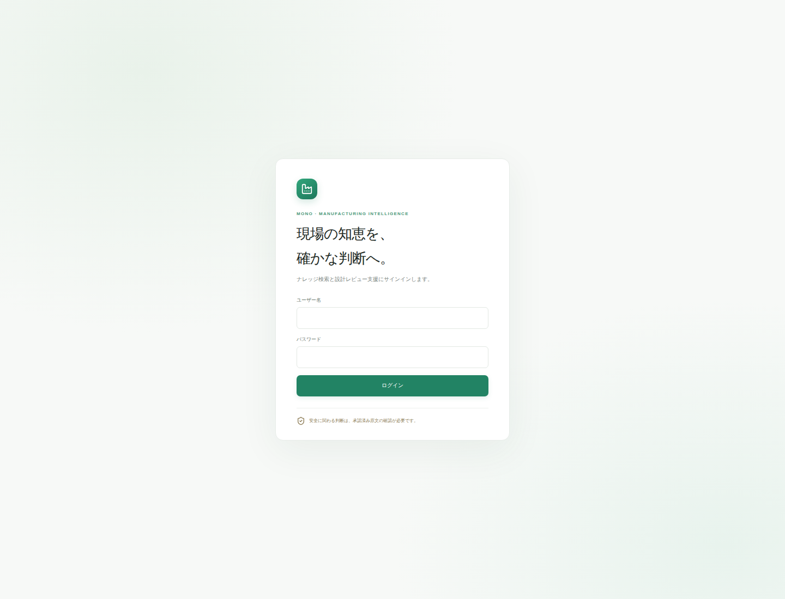
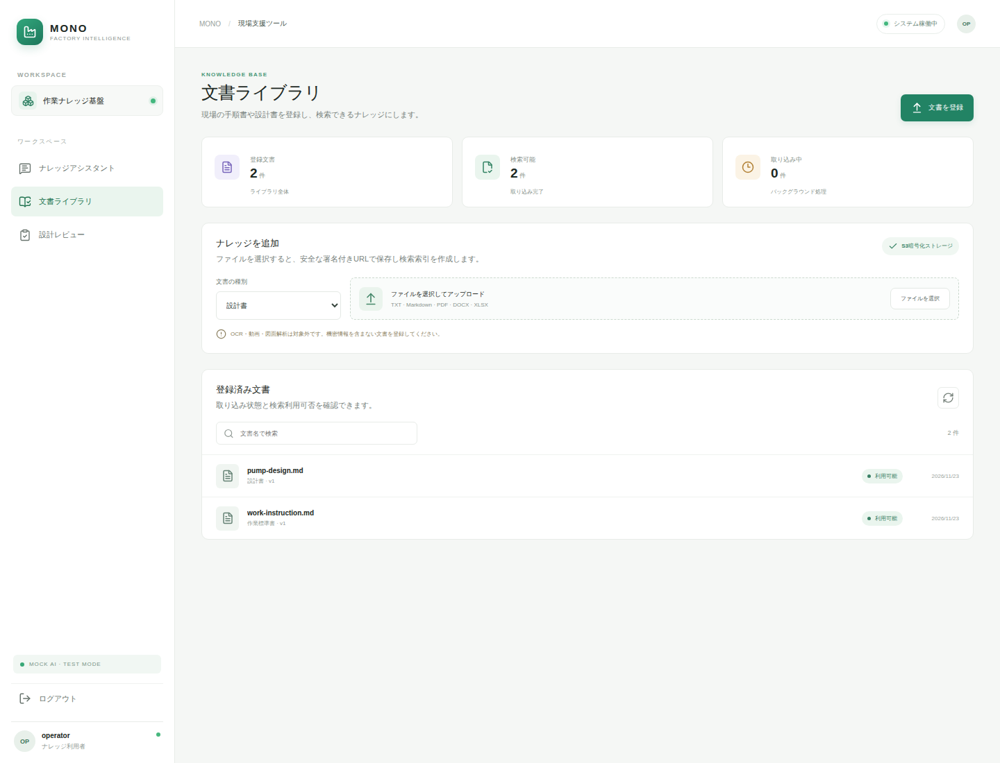
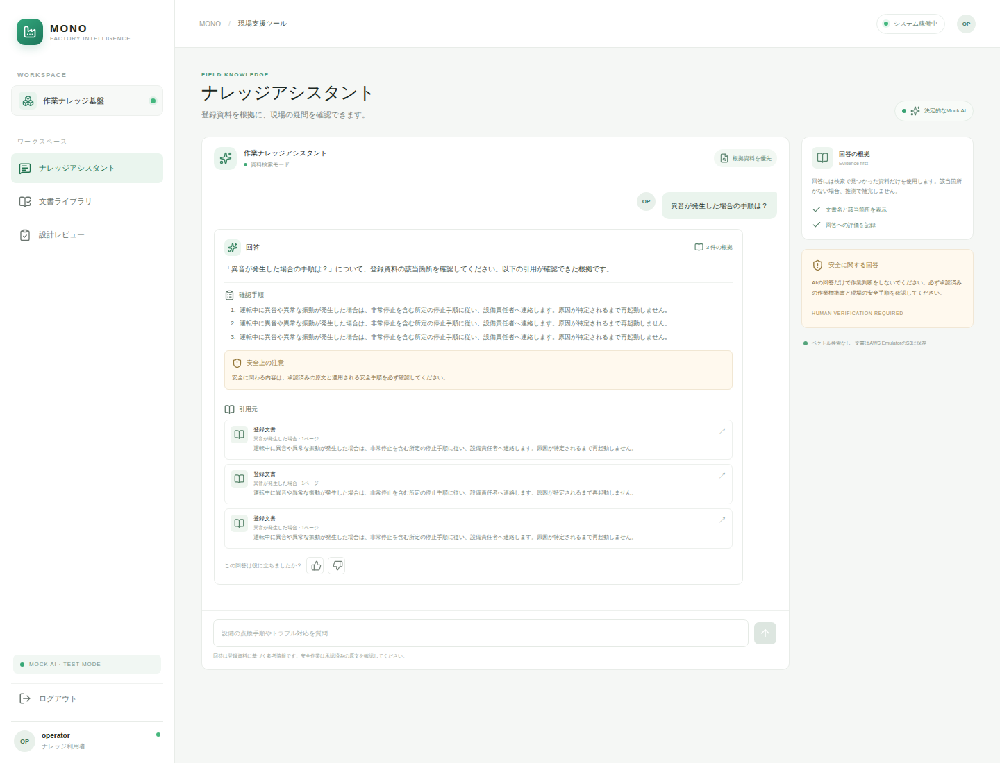
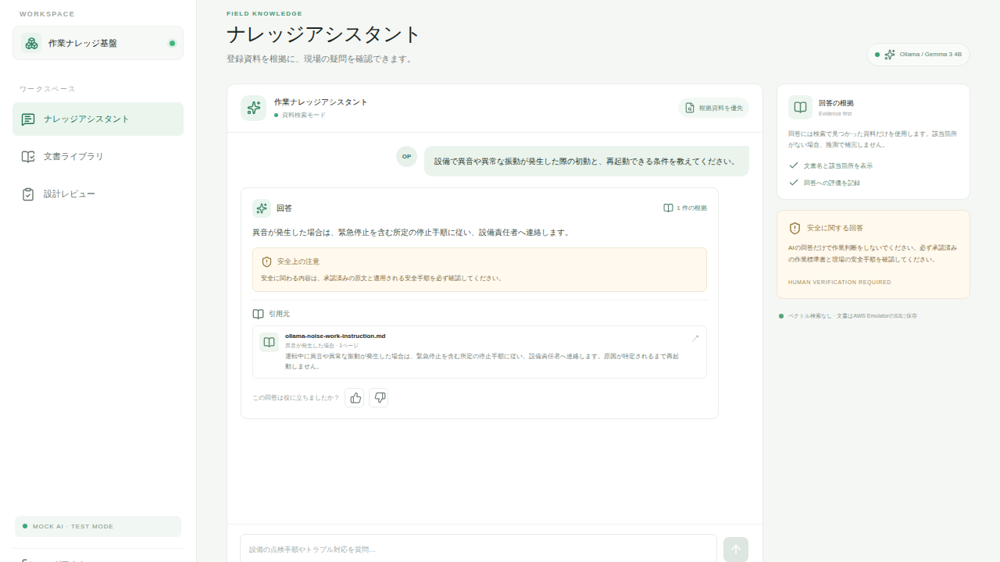
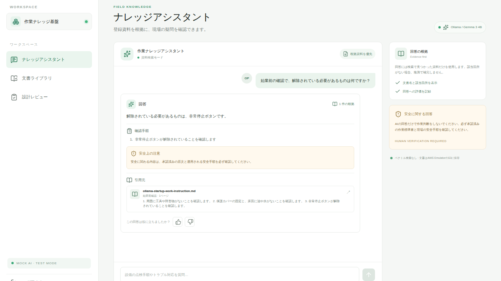
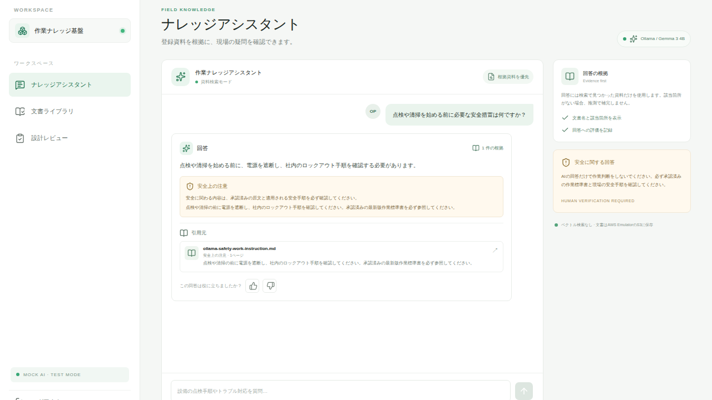
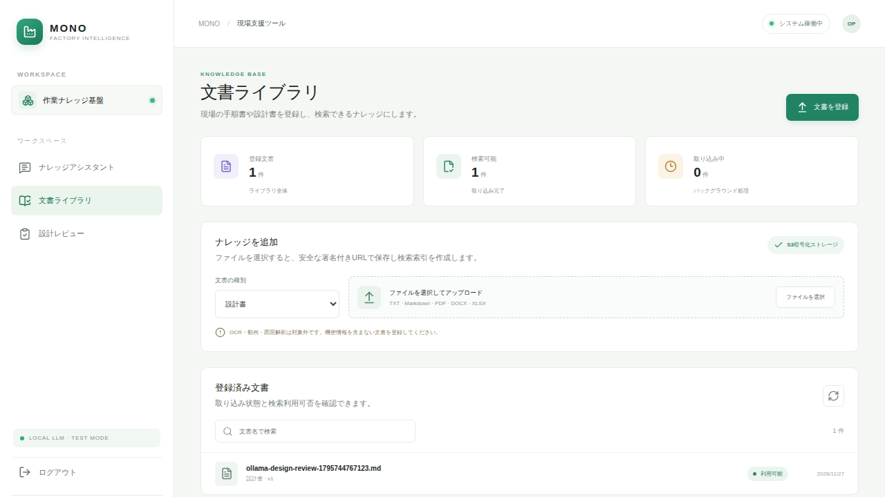
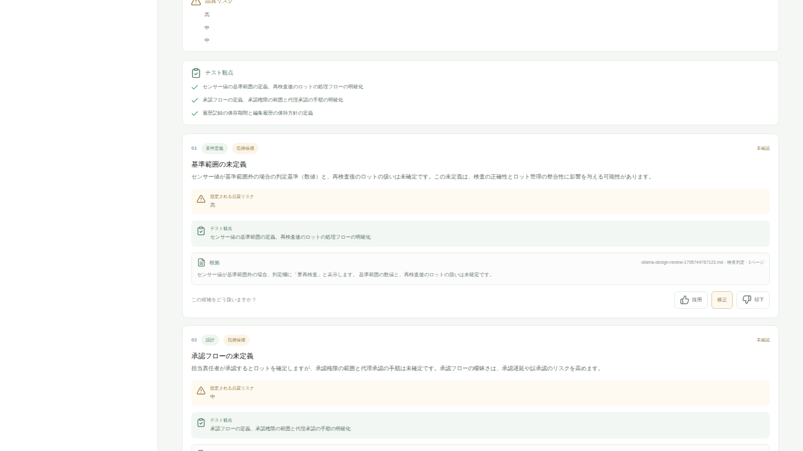
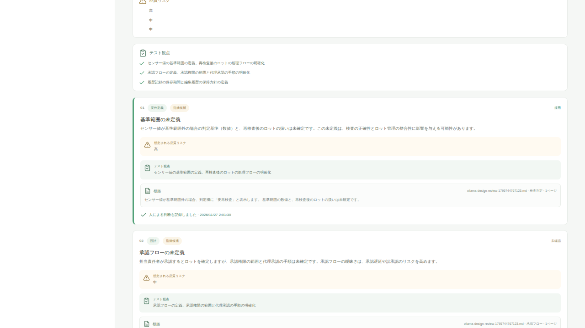

# 📖 操作マニュアル

このマニュアルはローカルPoCの画面を使い、文書を登録して質問・設計レビューを行う手順を説明します。

## 🧭 できること

| 順番 | 操作 | 完了の目印 |
| --- | --- | --- |
| 1️⃣ | ログイン | ナレッジアシスタント画面が表示される |
| 2️⃣ | 文書を登録 | 状態が「利用可能」になる |
| 3️⃣ | 資料について質問 | 回答と引用元を確認できる |
| 4️⃣ | 設計レビュー | 候補の根拠を見て人の判断を記録できる |

## 🔑 1. 起動してログイン

ターミナルでアプリを起動します。

```sh
pnpm dev:local
```

起動メッセージに `http://localhost:5173` が表示されたら、ブラウザーで開きます。初期設定のままなら、ユーザー名 `operator`、パスワード `change-me` でログインします。共有環境や公開環境では、この開発用アカウントを使わないでください。



画面下部には、安全に関わる判断は承認済み原文を確認するよう注意が表示されます。

## 📚 2. 文書を登録

1. 左側メニューの **文書ライブラリ** を開きます。
2. 「文書の種別」を選びます。通常の手順書やFAQは各種別、設計レビューを行う資料は **設計書** を選択します。
3. **ファイルを選択してアップロード** を押し、TXT、Markdown、PDF、DOCX、XLSXファイルを選択します。
4. 登録済み文書一覧で状態を確認します。**利用可能** になると、質問や設計レビューに使えます。



文書ライブラリはファイルをEmulator上のS3へ保存し、SQSとWorkerでテキストを取り込んで検索索引を作成します。登録・取り込み自体ではLLMを呼び出しません。ナレッジアシスタントと設計レビューが、登録済み文書の検索根拠をOllamaのローカルLLMへ渡します。

### 📄 対応ファイルと注意点

| 対応 | 補足 |
| --- | --- |
| TXT、Markdown | 文字情報を取り込みます |
| PDF、DOCX、XLSX | ファイルから抽出できた文字を取り込みます |
| 画像だけのPDF、動画、図面 | OCR・動画文字起こし・図面解析は対象外です |

🔒 まずは機密情報を含まないサンプル文書で操作してください。ローカルEmulatorのS3/DynamoDB/SQSは停止時に消去されます。

## 🔎 3. 資料に質問する

1. **ナレッジアシスタント** を開きます。
2. 質問例を選ぶか、入力欄に質問を入力します。
3. **↑** ボタンを押して送信します。
4. 回答の **引用元** に表示される文書名、該当箇所、抜粋を原文と照らし合わせます。
5. 必要に応じて「役に立った / 役に立たなかった」を選びます。



登録文書に該当する根拠がないと、資料が見つからない旨が表示されます。回答が表示されても内容の正確性は保証されません。安全作業では、承認済みの最新版作業標準書と現場の手順を確認してください。

## 🧪 4. 設計レビューを行う

1. 設計書を文書ライブラリに登録し、「利用可能」になるまで待ちます。
2. 登録時の種別が **設計書** であることを確認します。
3. **設計レビュー** を開き、対象文書を選択します。
4. **レビューを実行** を押します。
5. 各候補の説明、想定リスク、テスト観点、根拠を確認します。
6. 候補ごとに **採用**、**却下**、または **修正** を選びます。修正する場合は内容を編集して **修正を記録** を押します。

設計レビューはOllamaのローカルLLMが、選択した設計書から指摘候補を生成します。候補の文章は毎回変わり得るため固定文言とは照合せず、登録文書に対応する根拠とともに確認してください。

⚠️ AIが提示するのは指摘候補です。採用・却下・修正は担当者が根拠と要求仕様を確認して判断し、最終的な設計承認も担当者が行ってください。

## 🚪 ログアウトと終了

- ログアウトするには左側メニュー下部の **ログアウト** を押します。
- ローカルアプリとEmulatorを終了するには、`pnpm dev:local` を実行しているターミナルで `Ctrl+C` を押します。
- Emulator上のDynamoDB/S3/SQSデータは停止時に消去されます。必要な資料はローカル環境に別途保管してください。

## 🧯 困ったとき

| 状況 | 確認すること |
| --- | --- |
| 画面が開かない | 起動ターミナルに `VITE ... ready` が出ているか、port `5173` が使用中でないか確認 |
| ログインできない | `.env` の `AUTH_PROVIDER`、`AUTH_USERNAME`、`AUTH_PASSWORD` を確認。初期値を変更した場合は変更後の値を使用 |
| ファイルを登録できない | 対応形式か、起動ターミナルにS3/TLS/APIエラーがないか確認 |
| 文書が「利用可能」にならない | Workerが起動しているか、文書の状態やエラーマーク、ターミナルログを確認。最大3回失敗した文書は運用担当者がDLQとログを確認します |
| 質問に根拠が出ない | 文書が「利用可能」か、登録文書に質問内容が含まれているか確認 |
| port競合・TLSエラー | [アーキテクチャ資料のローカル起動メモ](./architecture.md#ローカル起動とデータの扱い)を確認 |

## 🧠 このPoCの前提

- 既定のLLMはGemma 3 4Bを提供するOllamaです。Ollamaが起動しておらず、`gemma3:4b` が取得されていない場合は利用できません。
- Ollama応答のE2Eをローカルで試す場合は、Ollamaを起動して `gemma3:4b` を取得し、別ターミナルで `pnpm dev:local` を起動してから `pnpm test:e2e:ollama` を実行します。公式AWS Emulator上のS3/DynamoDB/SQS、API、Worker、SQLite FTS5検索を経由します。回答JSON・結果画面のスクリーンショット・動画を確認するには `pnpm exec playwright show-report` を実行します。動画とスクリーンショットは1280 x 720で、動画は回答表示後に回答欄へスクロールし、ローディング終了後の回答本文を2秒間表示してから終わります。
- ログインユーザーが異なっても、文書とレビューは共有ワークスペースです。文書ごとの権限分離はありません。
- このアプリは本番運用向けの監視、バックアップ、可用性、アクセス制御を備えた完成システムではありません。

## 🧪 CIでのOllama / Gemma 3 4B応答例

[CI実行結果](https://github.com/kamn-sap/ai-manufacturing-poc/actions/runs/45919195841)と[Playwright Viewer](https://kamn-sap.github.io/ai-manufacturing-poc/e2e/index.html)から取得した、実モデルの応答例です。以下の画像はローカルで再現したものではなく、CI実行時の1280 x 720スクリーンショットです。応答時間は質問送信からAPI応答までの実測値です。

E2Eでは回答文の固定一致を要求しません。空でない回答、登録したシナリオ文書・節からの引用、引用抜粋と登録内容の対応、および結果画面への回答表示を検証します。回答文の意味的な完全性はこの自動検証だけでは保証されないため、引用元と照らして確認してください。このCI実行は成功しました。

### 異音・振動の異常対応

- **登録文書** `ollama-noise-work-instruction.md`

  > 運転中に異音や異常な振動が発生した場合は、緊急停止を含む所定の停止手順に従い、設備責任者へ連絡します。原因が特定されるまで再起動しません。

- **設問** 設備で異音や異常な振動が発生した際の初動と、再起動できる条件を教えてください。
- **Gemma 3 4Bの回答**（17.0秒）: 「異音が発生した場合は、緊急停止を含む所定の停止手順に従い、設備責任者へ連絡します。」
- **評価**: 初動は文書に沿っていますが、設問に含めた「再起動できる条件」は回答本文から抜けています。引用抜粋には「原因が特定されるまで再起動しません」とあります。CIは文言の完全性を判定していないため、この例のように人による確認が必要です。



### 始業前の確認項目

- **登録文書** `ollama-startup-work-instruction.md`

  > 始業前確認: 周囲に工具や障害物がないこと、保護カバーの固定と床面の状態、非常停止ボタンが解除されていることを確認します。

- **設問** 始業前の確認で、解除されている必要があるものは何ですか？
- **Gemma 3 4Bの回答**（10.9秒）: 「解除されている必要があるものは、非常停止ボタンです。」
- **評価**: 登録文書の確認項目と一致し、引用も対象文書の「始業前確認」節に限定されています。



### 清掃・点検時の安全措置

- **登録文書** `ollama-safety-work-instruction.md`

  > 点検や清掃の前に電源を遮断し、社内のロックアウト手順を確認してください。承認済みの最新版作業標準書を必ず参照してください。

- **設問** 点検や清掃を始める前に必要な安全措置は何ですか？
- **Gemma 3 4Bの回答**（15.4秒）: 「点検や清掃を始める前に、電源を遮断し、社内のロックアウト手順を確認する必要があります。」
- **評価**: 回答本文は電源遮断とロックアウトを挙げています。最新版作業標準書の参照は同じ画面の「安全上の注意」に表示され、引用にも含まれています。



### 文書ライブラリから設計レビューまでのE2E

追加の実LLMシナリオでは、[設計レビュー用fixture](../fixtures/ollama-design-review.md)を文書ライブラリから「設計書」として登録し、EmulatorのS3保存・SQS取り込み・Workerによる索引化を経て、設計レビュー画面で候補を生成します。最後に候補を採用し、利用者の判断が記録されるところまでを通します。文書ライブラリでの登録と取り込みにはLLMを使わず、設計レビューAPIの分析処理でOllama / Gemma 3 4Bを呼び出します。

**登録文書** `ollama-design-review-<run timestamp>.md`:

> - **検査判定**: センサー値が基準範囲外の場合、判定欄に「要再検査」と表示します。基準範囲の数値と、再検査後のロットの扱いは未確定です。
> - **承認フロー**: 担当責任者が承認するとロットを確定します。承認権限の範囲と代理承認の手順は未確定です。
> - **履歴記録**: 検査判定をデータベースに記録します。履歴の保存期間と編集履歴の保持方針は未確定です。

CIではモデル出力の固定文言ではなく、レビュー結果と候補が存在すること、各候補に必須項目があること、根拠が登録した設計書の節・抜粋に対応すること、採用操作が保存されることを検証します。複数の実LLMリクエストが競合して応答時間を悪化させないよう、Ollama E2Eは1 workerで順番に実行します。Playwrightレポートには登録文書・レビュー応答のJSON、登録完了画面・レビュー結果・判断後のスクリーンショットと動画が添付されます。

**CI実行結果**: [run 45925292912](https://github.com/kamn-sap/ai-manufacturing-poc/actions/runs/45925292912) は成功し、Ollamaを含むE2E 7件がすべて成功しました。[Playwright Viewer](https://kamn-sap.github.io/ai-manufacturing-poc/e2e/index.html)では、実行JSONと動画も確認できます。以下の画像はこのCI runから取得した1280 x 720のスクリーンショットです。

Gemma 3 4Bは、登録した設計書から次の3件を指摘しました。レビューAPIの応答時間は114.1秒です。

| 指摘 | リスク | 根拠 |
| --- | --- | --- |
| 基準範囲の未定義 | 高 | 「検査判定」: センサー値の判定基準と再検査後のロットの扱い |
| 承認フローの未定義 | 中 | 「承認フロー」: 承認権限の範囲と代理承認の手順 |
| 履歴記録の未定義 | 中 | 「履歴記録」: 保存期間と編集履歴の保持方針 |

いずれの引用も登録した設計書の該当節・抜粋に対応していました。担当者による操作のE2Eでは、1件目の「基準範囲の未定義」を採用し、判断記録が保存されたことを確認しています。候補の妥当性やリスク評価そのものを自動保証するものではないため、実際のレビューでは設計要求と原文を確認して判断してください。






