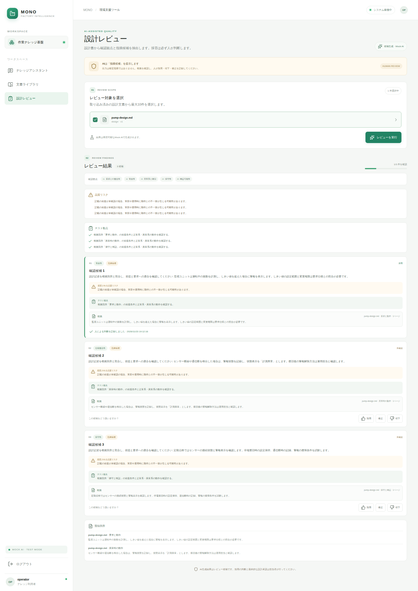

# 📖 操作マニュアル

このマニュアルはローカルPoCの画面を使い、文書を登録して質問・設計レビューを行う手順を説明します。

## 🧭 できること

| 順番 | 操作 | 完了の目印 |
| --- | --- | --- |
| 1️⃣ | ログイン | ナレッジアシスタント画面が表示される |
| 2️⃣ | 文書を登録 | 状態が「利用可能」になる |
| 3️⃣ | 資料について質問 | 回答と引用元を確認できる |
| 4️⃣ | 設計レビュー | 候補の根拠を見て人の判断を記録できる |

## 🔑 1. 起動してログイン

ターミナルでアプリを起動します。

```sh
pnpm dev:local
```

起動メッセージに `http://localhost:5173` が表示されたら、ブラウザーで開きます。初期設定のままなら、ユーザー名 `operator`、パスワード `change-me` でログインします。共有環境や公開環境では、この開発用アカウントを使わないでください。


画面下部には、安全に関わる判断は承認済み原文を確認するよう注意が表示されます。

## 📚 2. 文書を登録

1. 左側メニューの **文書ライブラリ** を開きます。
2. 「文書の種別」を選びます。通常の手順書やFAQは各種別、設計レビューを行う資料は **設計書** を選択します。
3. **ファイルを選択してアップロード** を押し、TXT、Markdown、PDF、DOCX、XLSXファイルを選択します。
4. 登録済み文書一覧で状態を確認します。**利用可能** になると、質問や設計レビューに使えます。


### 📄 対応ファイルと注意点

| 対応 | 補足 |
| --- | --- |
| TXT、Markdown | 文字情報を取り込みます |
| PDF、DOCX、XLSX | ファイルから抽出できた文字を取り込みます |
| 画像だけのPDF、動画、図面 | OCR・動画文字起こし・図面解析は対象外です |

🔒 まずは機密情報を含まないサンプル文書で操作してください。ローカルEmulatorのS3/DynamoDB/SQSは停止時に消去されます。

## 🔎 3. 資料に質問する

1. **ナレッジアシスタント** を開きます。
2. 質問例を選ぶか、入力欄に質問を入力します。
3. **↑** ボタンを押して送信します。
4. 回答の **引用元** に表示される文書名、該当箇所、抜粋を原文と照らし合わせます。
5. 必要に応じて「役に立った / 役に立たなかった」を選びます。


登録文書に該当する根拠がないと、資料が見つからない旨が表示されます。回答が表示されても内容の正確性は保証されません。安全作業では、承認済みの最新版作業標準書と現場の手順を確認してください。

## 🧪 4. 設計レビューを行う

1. 設計書を文書ライブラリに登録し、「利用可能」になるまで待ちます。
2. 登録時の種別が **設計書** であることを確認します。
3. **設計レビュー** を開き、対象文書を選択します。
4. **レビューを実行** を押します。
5. 各候補の説明、想定リスク、テスト観点、根拠を確認します。
6. 候補ごとに **採用**、**却下**、または **修正** を選びます。修正する場合は内容を編集して **修正を記録** を押します。



⚠️ AIが提示するのは指摘候補です。採用・却下・修正は担当者が根拠と要求仕様を確認して判断し、最終的な設計承認も担当者が行ってください。

## 🚪 ログアウトと終了

- ログアウトするには左側メニュー下部の **ログアウト** を押します。
- ローカルアプリとEmulatorを終了するには、`pnpm dev:local` を実行しているターミナルで `Ctrl+C` を押します。
- Emulator上のDynamoDB/S3/SQSデータは停止時に消去されます。必要な資料はローカル環境に別途保管してください。

## 🧯 困ったとき

| 状況 | 確認すること |
| --- | --- |
| 画面が開かない | 起動ターミナルに `VITE ... ready` が出ているか、port `5173` が使用中でないか確認 |
| ログインできない | `.env` の `AUTH_PROVIDER`、`AUTH_USERNAME`、`AUTH_PASSWORD` を確認。初期値を変更した場合は変更後の値を使用 |
| ファイルを登録できない | 対応形式か、起動ターミナルにS3/TLS/APIエラーがないか確認 |
| 文書が「利用可能」にならない | Workerが起動しているか、文書の状態やエラーマーク、ターミナルログを確認。最大3回失敗した文書は運用担当者がDLQとログを確認します |
| 質問に根拠が出ない | 文書が「利用可能」か、登録文書に質問内容が含まれているか確認 |
| port競合・TLSエラー | [アーキテクチャ資料のローカル起動メモ](./architecture.md#ローカル起動とデータの扱い)を確認 |

## 🧠 このPoCの前提

- 既定のLLMはGemma 3 4Bを提供するOllamaです。Ollamaが起動しておらず、`gemma3:4b` が取得されていない場合は利用できません。
- Ollama応答のE2Eをローカルで試す場合は、Ollamaを起動して `gemma3:4b` を取得し、別ターミナルで `pnpm dev:local` を起動してから `pnpm test:e2e:ollama` を実行します。公式AWS Emulator上のS3/DynamoDB/SQS、API、Worker、SQLite FTS5検索を経由します。回答JSONと動画を確認するには `pnpm exec playwright show-report` を実行します。動画は回答表示後に回答欄へスクロールし、ローディング終了後の回答本文を2秒間表示してから終わります。
- ログインユーザーが異なっても、文書とレビューは共有ワークスペースです。文書ごとの権限分離はありません。
- このアプリは本番運用向けの監視、バックアップ、可用性、アクセス制御を備えた完成システムではありません。
